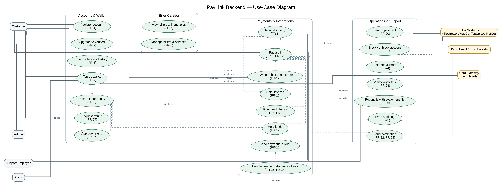

# PayLink - Phase 1: Requirements Pack (Part 1)

_Requirements & Product Lead deliverable: Problem Summary, Stakeholders, User Stories US-1 to US-9 (FR-1 to FR-9), Use-Case Diagram_

**Owner:** Student 1 (Requirements & Product Lead)  
**Status:** Ready for review (pull request `docs/requirements-p1`)

## 1. Problem Summary

PayLink is an Egyptian bill-payment company, comparable to Fawry or Vodafone Cash. Customers pay electricity, water, mobile and internet bills from a digital wallet, through the mobile app or through agents who operate a PayLink terminal in a shop. PayLink earns a small service fee on every payment and pays commission to agents.

The core problem is trust with money. PayLink holds customer funds, and every payment depends on an external biller that can be slow, can refuse, can answer twice, or can stay silent. If a customer is charged twice, charged for a payment the biller never received, or ends with a negative balance, the company loses money and trust and may face regulators. The company therefore needs a backend that is exactly correct with money (exact decimals, ledger-based balances, hold before charge), safe against duplicates and concurrent requests, and honest about uncertain states such as a payment that is still Unknown.

The system must also be easy to extend. Billers differ in protocol and behaviour (fast REST, slower SOAP-style XML, asynchronous callbacks, daily batch files), and a new biller or a new API version must only change that biller's integration, not the rest of the system. Finally, the system must be ready for the busiest day of the month (target: 100 payments per second) and must be auditable: every money movement and admin action must be traceable to who, when and why.

Scope of this phase: we capture the requirements (at least 25 testable user stories and 6 measurable non-functional requirements) and the design (use-case, class, sequence, state and ER diagrams), and we set up the repository, Docker and CI foundation. No business code is delivered in Phase 1 beyond the skeleton application.

## 2. Stakeholders

| Stakeholder | Role | Main interest / need |
|---|---|---|
| Customer | Pays bills from the wallet; tops up; sees balance and history. | Fast, correct payments; never charged twice; clear messages when something fails; own data stays private. |
| Agent | Shop owner with a PayLink terminal; pays on behalf of customers and takes cash top-ups. | Quick service at the counter; commission credited correctly (40% of the service fee). |
| Biller (ElectroCo, AquaCo, TopUpNet, NetCo) | Issues bills and receives payments through its own protocol. | Receives each payment exactly once, with a unique reference; matching settlement records. |
| PayLink management / Product owner | Owns the product and the business rules. | Revenue from fees; lower support cost; fast onboarding of new billers; readiness for peak days. |
| Support employee | Investigates payments, blocks accounts, approves refunds. | Search by reference with full history; clear reconciliation reports; safe block/unblock tools. |
| Admin / Operations | Manages billers, services, fees, limits and verification levels. | Change fees and limits through configuration without redeploying; daily totals; audit trail. |
| Finance / Reconciliation team | Checks that PayLink records agree with biller settlement files. | Daily difference report; no silent mismatches; exact decimal amounts. |
| Regulator (e.g. financial authority) | Supervises companies that hold customer money. | Complete audit log, no negative balances, traceable money movements, fraud controls. |
| Notification providers (SMS, email, push) | External systems that deliver messages. | Reasonable retry behaviour; no flooding when they are down. |
| Development team, instructors and TAs | Build, review and grade the system. | Clear requirements, traceable design, working Docker and CI from a clean clone. |

## 3. User Stories (FR-1 to FR-9)

Priorities use MoSCoW (Must, Should, Could), copied from the brief, section 3.2. Acceptance criteria are written as Given / When / Then. All money values are in EGP and use exact decimals.

| Story | Requirement | Title | Priority | Module |
|---|---|---|---|---|
| US-1 | FR-1 | Register an account | Must | Accounts & Wallet |
| US-2 | FR-2 | Upgrade a customer to verified | Should | Accounts & Wallet |
| US-3 | FR-3 | View wallet balance and transaction history | Must | Accounts & Wallet |
| US-4 | FR-4 | Top up the wallet | Must | Accounts & Wallet |
| US-5 | FR-5 | Ledger-based balances | Must | Accounts & Wallet |
| US-6 | FR-6 | Manage billers and services | Must | Biller Catalog |
| US-7 | FR-7 | See billers and required input fields | Must | Biller Catalog |
| US-8 | FR-8 | Run a bill inquiry before paying | Must | Payment Processing |
| US-9 | FR-9 | Pay a bill from the wallet | Must | Payment Processing |

### US-1 - Register an account (FR-1, Must)

**As** a new customer, **I want** to register with my phone number and name, **so that** I can own a wallet and start paying bills.

**Acceptance criteria**

1. **Given** a visitor with a valid Egyptian mobile number (01XXXXXXXXX) that is not yet registered and a non-empty name, **when** they submit the registration, **then** an account is created with verification level BASIC, and a wallet is created with available balance 0.00 EGP and held balance 0.00 EGP.
2. **Given** a phone number that already belongs to an account, **when** someone registers with that number, **then** the request is rejected with the reason "phone already registered" and no second account or wallet is created.
3. **Given** a registration request with an invalid phone number or an empty name, **when** it is submitted, **then** the system returns a validation error that names the invalid field, and nothing is stored.

_Note:_ Authentication method (password, OTP) is decided in the ambiguities list; the story only requires a valid unique identity.

### US-2 - Upgrade a customer to verified (FR-2, Should)

**As** an admin, **I want** to upgrade a BASIC customer to VERIFIED, **so that** the customer gets higher limits after identity checks.

**Acceptance criteria**

1. **Given** a customer with level BASIC and a daily limit of 5,000 EGP, **when** an admin upgrades the customer, **then** the level becomes VERIFIED and the daily limit read from configuration becomes 30,000 EGP immediately.
2. **Given** a customer that is already VERIFIED, **when** an admin upgrades the customer again, **then** no change is made, the request succeeds without error, and no duplicate audit entry is created.
3. **Given** a user who is not an admin, **when** they try to upgrade a customer, **then** the request is rejected as forbidden and the level is unchanged.
4. **Given** a successful upgrade, **when** it is saved, **then** an audit record is written with who, when, old level and new level.

_Note:_ Related: FR-18 (limit enforcement), FR-24 (limits in configuration), FR-25 (audit log).

### US-3 - View wallet balance and transaction history (FR-3, Must)

**As** a customer, **I want** to see my available balance, my held balance and my transaction history, **so that** I know how much I can spend and what happened to my money.

**Acceptance criteria**

1. **Given** a wallet with a top-up of 1,000.00 EGP and a payment of 352.50 EGP currently held, **when** the customer opens the wallet, **then** the system shows available 647.50 EGP and held 352.50 EGP.
2. **Given** a wallet with more than one transaction, **when** the customer opens the history, **then** transactions are listed newest first with date, type, amount, status and reference, in pages of a fixed size.
3. **Given** two different customers A and B, **when** customer A requests the wallet or history of customer B, **then** the request is rejected (forbidden or not found) and no data of B is returned.
4. **Given** a new wallet with no transactions, **when** the customer opens the history, **then** an empty list is returned and both balances are 0.00 EGP.

_Note:_ Balances shown here are computed from the ledger (see US-5).

### US-4 - Top up the wallet (FR-4, Must)

**As** a customer or an agent, **I want** to add money to a wallet by simulated card or by agent cash, **so that** the wallet has funds to pay bills.

**Acceptance criteria**

1. **Given** a customer with a simulated card that the card gateway approves, **when** the customer tops up 500.00 EGP, **then** a TOPUP ledger entry of +500.00 EGP is created and the available balance increases by exactly 500.00 EGP.
2. **Given** a simulated card that the gateway declines, **when** the customer tries to top up, **then** no ledger entry is created, the balance is unchanged and the customer sees the decline reason.
3. **Given** an agent whose wallet has at least 500.00 EGP and who received 500.00 EGP in cash from the customer, **when** the agent submits a cash top-up of 500.00 EGP for that customer, **then** the agent's wallet is debited and the customer's wallet is credited by 500.00 EGP in one atomic operation, with two ledger entries sharing one reference.
4. **Given** a top-up amount of 0 or a negative number, **when** it is submitted, **then** the request is rejected with a validation error and no ledger entry is created.

_Note:_ Assumption (to confirm in the ambiguities list): agent cash top-up debits the agent wallet. No maximum top-up value is given in the brief.

### US-5 - Ledger-based balances (FR-5, Must)

**As** the business and the auditors, **I want** every balance change to create a ledger entry and every balance to be computed from the ledger, **so that** money is traceable and balances cannot be overwritten.

**Acceptance criteria**

1. **Given** any money movement (top-up, hold, release, charge, fee, commission, refund), **when** it happens, **then** at least one new ledger entry is appended with id, wallet, type, signed amount, reference, timestamp and actor.
2. **Given** a wallet with a +1,000.00 EGP top-up recorded in the Available bucket and a 352.50 EGP hold recorded as two ledger entries (-352.50 EGP in Available and +352.50 EGP in Held), **when** the balance is requested, **then** available is computed as 647.50 EGP and held is computed as 352.50 EGP by summing the entries in each bucket; no stored balance field is read or edited directly.
3. **Given** an existing ledger entry, **when** any update or delete is attempted, **then** the attempt is rejected; corrections are made only by new compensating entries.
4. **Given** amounts 0.10 and 0.20 added in the ledger, **when** the total is computed, **then** the result is exactly 0.30 (exact decimal arithmetic, never floating point).

_Note:_ Foundation for FR-12 (holds), FR-25 (audit) and the zero-negative-balance target.

### US-6 - Manage billers and services (FR-6, Must)

**As** an admin, **I want** to add, edit and disable billers and their services, **so that** the catalog stays correct without changing code.

**Acceptance criteria**

1. **Given** an authenticated admin, **when** they add the biller ElectroCo with service Electricity, required field meter number, minimum 5.00 and maximum 10,000.00 EGP, **then** the biller and service are saved as active and appear in the catalog.
2. **Given** an existing service, **when** an admin edits its minimum amount or required fields, **then** the new values are saved and used for new payments only.
3. **Given** an active biller, **when** an admin disables it, **then** it disappears from the customer list, new payments to it are rejected with "biller unavailable", and payments already in progress continue.
4. **Given** a user who is not an admin, **when** they try to add, edit or disable a biller, **then** the request is rejected as forbidden.
5. **Given** any successful change to a biller or service, **when** it is saved, **then** an audit record with who, when and what changed is written.

_Note:_ Related: FR-15 (supported billers), FR-25 (audit).

### US-7 - See billers and required input fields (FR-7, Must)

**As** a customer, **I want** to see the list of active billers, their services and the fields each one needs, **so that** I know what information to enter before paying.

**Acceptance criteria**

1. **Given** active billers ElectroCo (meter number), AquaCo (customer code) and TopUpNet (phone number), **when** the customer opens the biller list, **then** each active biller is shown with its services and its required input fields.
2. **Given** a disabled biller, **when** the customer opens the biller list, **then** the disabled biller is not shown.
3. **Given** a service with minimum 5.00 EGP and maximum 10,000.00 EGP, **when** the customer opens the service, **then** the minimum and maximum amounts are displayed with the input fields.

_Note:_ Field names shown to customers come from the catalog, not from the biller adapter.

### US-8 - Run a bill inquiry before paying (FR-8, Must)

**As** a customer, **I want** to run a bill inquiry and see the amount, the fee and the total, **so that** I know exactly what I will pay before I confirm.

**Acceptance criteria**

1. **Given** customer Sara and ElectroCo meter 12345678 with a bill of 350.00 EGP, normal fee 2.50 EGP, **when** Sara runs the inquiry, **then** the system shows amount 350.00, fee 2.50 and total 352.50 EGP.
2. **Given** a mobile top-up of 100.00 EGP on TopUpNet (fee 1.5%, minimum 1 EGP), **when** the customer asks for the total, **then** the fee is 1.50 EGP and the total is 101.50 EGP; for a top-up of 20.00 EGP the fee is the minimum 1.00 EGP.
3. **Given** a meter number that has no bill, **when** the customer runs the inquiry, **then** the system answers "bill not found", and no payment and no hold are created.
4. **Given** a biller that does not answer within 10 seconds during the inquiry, **when** the customer runs the inquiry, **then** the customer is told the service is temporarily unavailable, and the wallet is not changed.
5. **Given** an inquiry, **when** it completes in any outcome, **then** the wallet balances and the ledger are unchanged.

_Note:_ Fee values come from configuration (FR-16, FR-24). NetCo has no live inquiry, so the customer enters the amount.

### US-9 - Pay a bill from the wallet (FR-9, Must)

**As** a customer, **I want** to pay a bill from my wallet, **so that** I settle my bill without queueing at the biller's office.

**Acceptance criteria**

1. **Given** Sara has 1,000.00 EGP available and an ElectroCo bill of 350.00 EGP with fee 2.50 EGP, **when** she confirms the payment and ElectroCo confirms it, **then** the payment ends Completed; 352.50 EGP is first held (available 647.50, held 352.50), then charged (held 0.00); PayLink fee income 2.50 EGP is recorded; Sara receives a unique payment reference.
2. **Given** a wallet with 100.00 EGP available and a total of 352.50 EGP, **when** the customer confirms the payment, **then** the payment is Rejected with the reason "insufficient funds", no money is held and the biller is not called.
3. **Given** a total charge (bill amount plus service fee) below 5.00 EGP or above 10,000.00 EGP, **when** the customer confirms the payment, **then** the payment is Rejected with the reason "total amount outside allowed range" and nothing is held.
4. **Given** a blocked account, **when** the customer confirms the payment, **then** the payment is Rejected with the reason "account blocked" and nothing is held.
5. **Given** the customer confirms a payment, **when** the system processes it, **then** funds are held before the biller is called and the full payment history is stored (see US-10 to US-14 for idempotency, life cycle, timeout and callbacks).

_Note:_ Core story. Detailed failure behaviour is covered by FR-10 to FR-14 (written by Student 2) and FR-18 to FR-19 (Student 3).

## 4. Use-Case Diagram

Source: [`/docs/design/use-case.puml`](design/use-case.puml). The PNG is a visual preview of the same use cases and relationships. Keep the PlantUML source as the editable source of truth.



**Actors:** Customer, Agent, Admin, Support Employee (internal); Biller Systems, SMS/Email/Push Provider, Card Gateway (external).

## 5. Traceability (FR to story to use case)

| FR | Story | Use case in diagram |
|---|---|---|
| FR-1 | US-1 | Register account |
| FR-2 | US-2 | Upgrade to verified |
| FR-3 | US-3 | View balance & history |
| FR-4 | US-4 | Top up wallet |
| FR-5 | US-5 | Record ledger entry |
| FR-6 | US-6 | Manage billers & services |
| FR-7 | US-7 | View billers & input fields |
| FR-8 | US-8 | Run bill inquiry |
| FR-9 | US-9 | Pay a bill |

## 6. Open questions passed to Student 2 (for the ambiguities list)

| # | Question | Assumption used in the stories |
|---|---|---|
| Q1 | How does a user log in (password, OTP)? The brief says "login" but gives no method. | Out of scope for Phase 1; stories only need a unique phone-based identity (US-1). |
| Q2 | Does an agent cash top-up debit the agent's wallet? | Yes, atomically, with two ledger entries (US-4). |
| Q3 | Is there a maximum top-up amount? | No limit in the brief; only values greater than 0 are accepted (US-4). |
| Q4 | Who verifies a customer (FR-2)? | An admin, after an identity check done outside the system (US-2). |
| Q5 | NetCo has no live inquiry, so where does the amount come from? | The customer enters it (US-8). |
| Q6 | Does the 5.00–10,000.00 EGP single-payment range include the service fee? | US-9 currently applies the range to the total charge (bill amount plus fee); confirm this interpretation with the team. |

## 7. Repository setup notes (Student 1)
```bash
# Student 1 - repository setup (run once)
gh repo create paylink --private --clone
cd paylink
mkdir -p docs/design .github/workflows
git add . && git commit -m "chore: initial structure"
git push -u origin main
# add collaborators: instructor, TAs, teammates (Settings > Collaborators)
# protect main: Settings > Branches > Add rule > main
#   [x] Require a pull request before merging (1 approval)
#   [x] Require status checks to pass (after Student 4's CI exists)
#   [x] Do not allow bypassing the above settings
# work on a branch and open a PR:
git checkout -b docs/requirements-p1
git add docs/req-p1.md docs/design/use-case.puml
git commit -m "docs: requirements part 1 and use-case diagram (AI-assisted: Claude)"
git push -u origin docs/requirements-p1
# after all students are merged and the final PDF is ready:
git tag phase-1
git push origin phase-1
```
