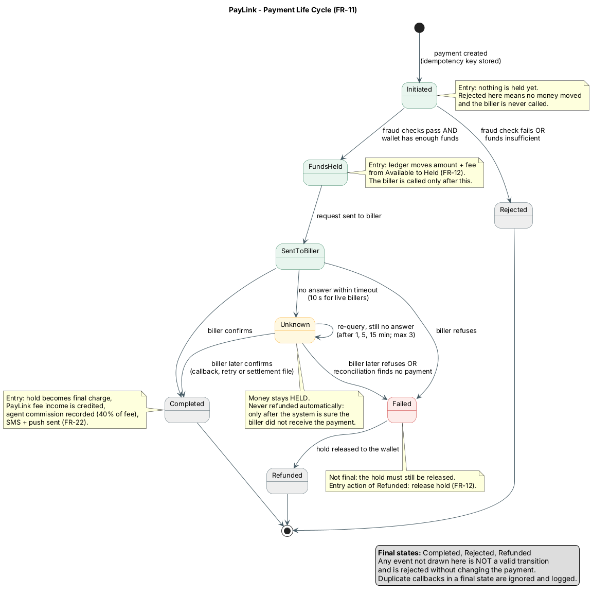

# PayLink - Phase 1: Requirements Pack (Part 2)

_Requirements Co-Lead & AI Log Lead deliverable: User Stories US-10 to US-19 (FR-10 to FR-19), Non-Functional Requirements, Ambiguities and Decisions, Payment State Diagram_

**Owner:** Student 2 (Requirements Co-Lead & AI Log Lead)  
**Status:** Ready for review (pull request `docs/requirements-p2`)  
**Continues:** [`req-p1.md`](req-p1.md) (US-1 to US-9). Same conventions: MoSCoW priorities from the brief (section 3.2), acceptance criteria in Given / When / Then, all money in EGP with exact decimals.

## 1. User Stories (FR-10 to FR-19)

| Story | Requirement | Title | Priority | Module |
|---|---|---|---|---|
| US-10 | FR-10 | Idempotent payment requests | Must | Payment Processing |
| US-11 | FR-11 | Enforce the payment life cycle | Must | Payment Processing |
| US-12 | FR-12 | Hold funds before calling the biller | Must | Accounts & Wallet / Payment Processing |
| US-13 | FR-13 | Handle biller timeout and retries | Must | Biller Integration |
| US-14 | FR-14 | Accept asynchronous callbacks and ignore duplicates | Must | Biller Integration |
| US-15 | FR-15 | Support billers with different formats | Must | Biller Integration |
| US-16 | FR-16 | Calculate service fees | Must | Fees & Commissions |
| US-17 | FR-17 | Agent pays on behalf of a customer | Should | Payment Processing / Fees & Commissions |
| US-18 | FR-18 | Reject payments above single or daily limits | Must | Fraud Checks |
| US-19 | FR-19 | Block an account after too many payments | Should | Fraud Checks |

### US-10 - Idempotent payment requests (FR-10, Must)

**As** a customer on a slow network, **I want** a repeated payment request to return the first result, **so that** I am never charged twice.

**Acceptance criteria**

1. **Given** a payment request with idempotency key K that was processed and ended Completed, **when** the same customer sends the same request with key K again, **then** the system returns the original result (same payment reference and state), creates no new payment, no new hold, no new ledger entry and makes no new biller call.
2. **Given** a payment request with key K that is still being processed, **when** the same request arrives again at the same moment, **then** only one payment is created and the second request returns the same payment reference with its current state.
3. **Given** a key K already used for a payment of 350.00 EGP, **when** a request with key K arrives with different content (another amount or another bill), **then** it is rejected with the reason "idempotency key reused with different request" and nothing is changed.
4. **Given** a payment request without an idempotency key, **when** it is submitted, **then** it is rejected with a validation error naming the missing key and no payment is created.
5. **Given** two different customers who send the same key value, **when** both submit, **then** each gets their own payment (keys are scoped per customer).

_Note:_ Covers hard case 1. Key retention time and scope are decided in the ambiguities list (A-8).

### US-11 - Enforce the payment life cycle (FR-11, Must)

**As** the business, **I want** every payment to be in exactly one state and to follow only the allowed transitions, **so that** a payment can never reach an impossible or unsafe state.

**Acceptance criteria**

1. **Given** a new payment, **when** it is created, **then** its state is Initiated and the creation is recorded in the payment history with time and reason.
2. **Given** each allowed transition in section 2.5 of the brief (Initiated to FundsHeld or Rejected; FundsHeld to SentToBiller; SentToBiller to Completed, Failed or Unknown; Unknown to Completed or Failed; Failed to Refunded), **when** its event happens, **then** the state changes to the target state and the history records the old state, the new state, the event and the time.
3. **Given** any pair of states that is not in the allowed table (for example Initiated to Completed, or Completed to Failed), **when** the system tries to apply it, **then** the change is refused, the state stays the same and the attempt is logged.
4. **Given** a payment in a final state (Completed, Rejected or Refunded), **when** any event arrives (late callback, retry result, settlement file line), **then** the state does not change.
5. **Given** a payment in Unknown, **when** the system evaluates it, **then** it is never moved to Refunded directly and is never refunded automatically; it must first become Failed.

_Note:_ Source for [`design/state-payment.puml`](design/state-payment.puml). Test idea: a table-driven test that tries all 8 x 8 state pairs and expects only the 9 allowed ones to pass.

### US-12 - Hold funds before calling the biller (FR-12, Must)

**As** a customer, **I want** my money to be held before the biller is called and released if the payment fails, **so that** I am not charged for a payment that did not happen and cannot overspend.

**Acceptance criteria**

1. **Given** Sara has 1,000.00 EGP available and a payment total of 352.50 EGP, **when** the fraud checks pass, **then** two ledger entries move 352.50 EGP from Available to Held (available 647.50, held 352.50), the payment becomes FundsHeld, and only then is the biller called.
2. **Given** a payment in state Failed with 352.50 EGP held, **when** the failure is confirmed, **then** the hold is released to the wallet by a new ledger entry (available back to 1,000.00, held 0.00) and the payment becomes Refunded.
3. **Given** a payment in state Unknown, **when** time passes, **then** the hold stays in place and is not released until the payment is Completed or Failed.
4. **Given** a wallet with 400.00 EGP available and two payments of 352.50 EGP arriving at the same moment, **when** both are processed, **then** exactly one becomes FundsHeld and the other is Rejected with the reason "insufficient funds"; the available balance never goes below 0.00.
5. **Given** a payment that completes, **when** the biller confirms, **then** the hold becomes a final charge: Held decreases by 352.50, bill amount 350.00 is recorded as paid to the biller, and fee 2.50 as PayLink fee income.

_Note:_ Covers hard case 4. Depends on US-5 (ledger). Concurrency control technique (row lock or optimistic version) is a design decision in the ADR, not a requirement.

### US-13 - Handle biller timeout and retries (FR-13, Must)

**As** a customer, **I want** a payment that does not get an answer to be handled safely and retried, **so that** I am neither charged without payment nor refunded wrongly.

**Acceptance criteria**

1. **Given** ElectroCo takes 12 seconds to answer while the timeout is 10 seconds, **when** the payment is sent, **then** after 10 seconds the payment becomes Unknown, the money stays held and the customer is told "your payment is being processed".
2. **Given** a payment in Unknown, **when** 1, 5 and 15 minutes have passed since it became Unknown, **then** the system re-queries the biller at each of these times, at most 3 times in total.
3. **Given** a re-query in which the biller says the payment was received, **when** the answer arrives, **then** the payment becomes Completed (charge, fee and notification as in US-12 criterion 5).
4. **Given** a re-query in which the biller says it refused, **when** the answer arrives, **then** the payment becomes Failed, then Refunded when the hold is released.
5. **Given** three re-queries that all got no answer, **when** the last one ends, **then** the payment stays Unknown with the money held and waits for reconciliation (FR-26); no automatic refund happens.
6. **Given** a retry or re-query, **when** it is sent, **then** it uses the original payment reference so the biller cannot receive the same payment twice.

_Note:_ Covers hard case 2. Timeout and retry delays come from configuration. Not applied to NetCo (batch).

### US-14 - Accept asynchronous callbacks and ignore duplicates (FR-14, Must)

**As** the system, **I want** to accept the final result that TopUpNet sends later by callback and to ignore repeated callbacks, **so that** a payment completes exactly once.

**Acceptance criteria**

1. **Given** a TopUpNet payment in state SentToBiller (the biller answered "accepted"), **when** TopUpNet calls the callback URL with "success" and the payment reference, **then** the payment becomes Completed.
2. **Given** a TopUpNet payment in state SentToBiller, **when** the callback says "failed", **then** the payment becomes Failed and then Refunded as in US-12 criterion 2, and the customer gets an SMS with the reason.
3. **Given** a payment that is already Completed, **when** TopUpNet calls the callback with "success" a second time, **then** the payment is not changed, no second charge, fee, commission or notification is created, and the duplicate is written to the log.
4. **Given** a payment in Unknown, **when** a valid callback "success" arrives, **then** the payment becomes Completed.
5. **Given** a callback for a payment reference that does not exist or has an invalid signature or secret, **when** it arrives, **then** it is rejected, nothing changes and the attempt is logged.
6. **Given** a callback whose result conflicts with a final state (for example "success" for a payment that is Refunded), **when** it arrives, **then** the payment is not changed and the conflict is flagged for support in the reconciliation report.

_Note:_ Covers hard case 6. Callback authentication method is decided in A-10.

### US-15 - Support billers with different formats (FR-15, Must)

**As** PayLink management, **I want** at least ElectroCo, AquaCo and TopUpNet supported through one adapter each, **so that** the rest of the system does not depend on any biller's protocol and billers can fail independently.

**Acceptance criteria**

1. **Given** ElectroCo (REST/JSON), AquaCo (SOAP-style XML) and TopUpNet (REST/JSON, asynchronous), **when** a payment is made to each, **then** the Payment Processing module uses the same internal request and result model for all three and never sees the biller's field names or error codes.
2. **Given** AquaCo refuses a payment with a biller-specific error code, **when** the adapter receives it, **then** the code is translated to a standard reason, the payment becomes Failed, the hold is released (Refunded) and the customer gets an SMS with a clear reason.
3. **Given** AquaCo rejects any payment above the bill amount, **when** a customer pays more than the inquiry amount, **then** the payment is stopped before the biller call with the reason "amount above bill" or, if it reaches the biller, handled as in criterion 2.
4. **Given** ElectroCo is down, **when** customers pay AquaCo and TopUpNet bills, **then** those payments are processed normally; only ElectroCo payments end Unknown or Failed.
5. **Given** a new biller, **when** it is added, **then** only a new adapter and its configuration are added and no existing module changes. NetCo (daily batch file) is optional.

_Note:_ Covers hard cases 3 and 8. Related: FR-6 (catalog), resilience target in section 2.

### US-16 - Calculate service fees (FR-16, Must)

**As** PayLink management, **I want** the service fee to follow the business rules, **so that** the company earns the right fee and the customer sees the right total.

**Acceptance criteria**

1. **Given** an electricity or water bill of any valid amount, **when** the fee is calculated, **then** it is the fixed value 2.50 EGP.
2. **Given** a mobile top-up, **when** the fee is calculated, **then** it is 1.5% of the amount with a minimum of 1.00 EGP: 100.00 gives 1.50; 20.00 gives 1.00 (minimum applies); 123.45 gives 1.85 (rounded to 2 decimals, see A-6).
3. **Given** an internet bill, **when** the fee is calculated, **then** it is 2.00 EGP for an amount up to and including 200.00 EGP and 4.00 EGP for an amount above 200.00 EGP.
4. **Given** a promotion configured for one biller with a start and an end date, **when** a payment is made to that biller inside the period (both dates included), **then** the fee is 0.00 EGP; outside the period or for another biller the normal fee applies.
5. **Given** any fee calculation, **when** it is done, **then** all values come from configuration (no fee value in code) and all arithmetic uses exact decimals.
6. **Given** a payment where the fee was calculated at inquiry time, **when** the payment is confirmed, **then** the same fee is used even if the configuration changed in between.

_Note:_ Related: FR-24 (edit fees without redeploying), US-8 (shows the fee), US-17 (commission is 40% of this fee).

### US-17 - Agent pays on behalf of a customer (FR-17, Should)

**As** an agent at a PayLink terminal, **I want** to pay a bill for a customer and earn commission, **so that** customers without the app can pay and I am rewarded.

**Acceptance criteria**

1. **Given** an agent wallet with at least 352.50 EGP and a customer who gives the agent 352.50 EGP in cash, **when** the agent pays the ElectroCo bill of 350.00 EGP (fee 2.50) and ElectroCo confirms, **then** the payment is Completed, it is marked with the agent as the channel, and the receipt is issued to the customer.
2. **Given** a completed agent payment with fee 2.50 EGP, **when** the payment completes, **then** a commission of 1.00 EGP (40% of the fee) is credited to the agent wallet by a ledger entry and PayLink fee income is reduced accordingly in the report (net 1.50 EGP).
3. **Given** an agent payment that ends Failed, Rejected or Unknown, **when** the state changes, **then** no commission is credited; for Unknown it is credited only if the payment later becomes Completed.
4. **Given** an agent wallet with less than the total, **when** the agent pays, **then** the payment is Rejected with the reason "insufficient funds".
5. **Given** an agent payment with a promotion fee of 0.00 EGP, **when** it completes, **then** the commission is 0.00 EGP and no commission entry is created.
6. **Given** a user who is not an agent, **when** they try to pay on behalf of a customer, **then** the request is rejected as forbidden.

_Note:_ Whose wallet pays is decided in A-9. The commission percentage comes from configuration.

### US-18 - Reject payments above single or daily limits (FR-18, Must)

**As** the business and the regulator, **I want** payments above the single-payment limit or the daily limit to be rejected with a clear reason, **so that** exposure to fraud and losses is limited.

**Acceptance criteria**

1. **Given** a total charge of 10,000.01 EGP or 4.99 EGP, **when** the customer confirms the payment, **then** it is Rejected with the reason "total amount outside allowed range (5.00 - 10,000.00 EGP)" and nothing is held.
2. **Given** a BASIC account with 4,800.00 EGP already counted today and a new payment of 300.00 EGP, **when** it is confirmed, **then** it is Rejected with the reason "daily limit exceeded (5,000.00 EGP)" and nothing is held.
3. **Given** a VERIFIED account with 29,000.00 EGP counted today, **when** it pays 1,000.00 EGP, **then** the payment is accepted because the total is exactly 30,000.00 EGP; a payment of 1,000.01 EGP is Rejected.
4. **Given** an earlier payment that ended Failed, Rejected or Refunded, **when** the daily total is computed, **then** that payment is not counted; Completed payments and payments in FundsHeld, SentToBiller and Unknown are counted.
5. **Given** the daily limit values in configuration, **when** an admin changes them (FR-24), **then** the new values are used for the next payment without redeploying.
6. **Given** a payment at 00:00 Cairo time of the next day, **when** the daily total is computed, **then** the new day starts with 0.00 EGP.

_Note:_ Part of the fraud chain. Interpretation of the range (with or without fee) follows Q6 / A-5.

### US-19 - Block an account after too many payments (FR-19, Should)

**As** the business, **I want** an account that makes more than 5 payments in 60 seconds to be blocked for 10 minutes, **so that** automated attacks and runaway clients are stopped.

**Acceptance criteria**

1. **Given** an account that has made 5 payments in the last 60 seconds, **when** it submits a 6th payment within the same 60 seconds, **then** the 6th is Rejected with the reason "too many payments, account blocked for 10 minutes" and the account is blocked.
2. **Given** an account that is blocked by this rule, **when** it submits any payment during the next 10 minutes, **then** the payment is Rejected with the reason "account blocked" and nothing is held.
3. **Given** a block that started 10 minutes ago, **when** the account submits a payment after the block time ended, **then** the block is removed automatically and the payment is processed normally.
4. **Given** exactly 5 payments in 60 seconds, **when** the account submits a payment 61 seconds after the first one, **then** it is not blocked (sliding 60-second window).
5. **Given** a repeated request with an already used idempotency key (US-10), **when** it arrives, **then** it does not count as a new payment for this rule.
6. **Given** an account blocked by this rule, **when** a support employee unblocks it (FR-21), **then** the block ends immediately and the action is written to the audit log.

_Note:_ Window length, count and block time come from configuration. Payments already in progress when the block starts are not cancelled.

## 2. Non-Functional Requirements (6, measurable)

Each requirement has a number and a way to measure it, so a test or a CI report can show it. Targets follow the brief (section 3.3).

| ID | Quality | Requirement (with number) | How it is measured | Related stories |
|---|---|---|---|---|
| NFR-1 | Correctness (money) | Zero double charges and zero negative balances. In a test with 100 parallel payments on one wallet that can pay only 1 of them, and in a test that sends the same idempotency key 50 times in parallel, exactly 1 charge is made and the final balance is >= 0.00 EGP. All money uses exact decimal types. | Automated concurrency and duplicate tests (hard cases 1 and 4) in CI; ledger sum check after each test | US-5, US-10, US-12 |
| NFR-2 | Performance | The system sustains 100 payments per second for 60 seconds (6,000 payments) against the mock billers, with an error rate below 1% and a 95th percentile response time of 500 ms or less for the PayLink part of a payment (biller time excluded). | Load-test script (for example k6 or Locust) run against docker compose; result stored in the report | US-9, US-15 |
| NFR-3 | Resilience | If one biller is down or slow, payments to the other billers continue: with ElectroCo stopped for 5 minutes, at least 99% of AquaCo and TopUpNet payments in the same period still reach a final state or SentToBiller, and a payment to the failed biller returns an answer within 10 seconds (timeout) instead of hanging. | Chaos test with a mock biller set to "fail on purpose" or "delay 12 s" (hard case 2) | US-13, US-15 |
| NFR-4 | Modifiability | Adding a new biller, or the ElectroCo API v2 change, touches only the Biller Integration module and configuration: 0 files changed in the other modules (checked with the list of changed paths of the commit). A new biller takes no more than 1 new adapter class, 1 configuration entry and its tests. | `git diff --name-only` review and the hard-case 8 test; reported in the Phase 2 change-request section | US-15, US-16 |
| NFR-5 | Auditability | 100% of money movements and admin actions have an audit record with who, when and why. Ledger and audit entries cannot be updated or deleted by the application (0 successful update or delete attempts in tests). | Test that counts ledger entries versus audit records per scenario and must be equal; coverage report of audited operations | US-2, US-5, US-6 |
| NFR-6 | Testability | At least 70% line coverage on domain logic, measured by the CI pipeline on every push; every one of the 8 hard cases has at least 1 automated test. | Coverage report in GitHub Actions; the build fails if coverage is below 70% | All stories |

_Optional extra (not counted in the 6):_ Notification delivery - a failed SMS or email is retried 3 times and then marked undelivered, and a notification failure never changes the payment result (hard case 5, FR-23).

## 3. Ambiguities, Questions and Decisions

The brief and the first AI drafts left several points open. Each one is listed with the question, the options, the decision the team made for Phase 1 and the story it affects. "Team decision" means the requirements leads decided it; items marked **Confirm** should be confirmed with the TA before Phase 2 coding starts.

### 3.1 Questions passed from Student 1 (Q1 to Q6)

| # | Question | Decision | Affects |
|---|---|---|---|
| Q1 / A-1 | How does a user log in (password, OTP)? | Out of scope for the payment rules. Phase 1 design assumes login by phone number and password with a token; OTP is a later improvement. Every protected endpoint needs a logged-in user with a role (Customer, Agent, Admin, Support). | US-1, all |
| Q2 / A-2 | Does an agent cash top-up debit the agent's wallet? | Yes. The agent wallet is debited and the customer wallet credited in one atomic operation (two ledger entries, one reference). | US-4, US-17 |
| Q3 / A-3 | Maximum top-up amount? | No maximum in the brief. Only an amount greater than 0 is accepted; a configurable maximum can be added later. | US-4 |
| Q4 / A-4 | Who verifies a customer (FR-2)? | An admin, after an identity check done outside the system. | US-2 |
| Q5 / A-11 | Where does the amount come from for NetCo (no live inquiry)? | The customer enters it, checked against the service minimum and maximum. | US-8, US-15 |
| Q6 / A-5 | Does the 5 - 10,000 EGP range include the service fee? | **Decision:** the range applies to the total charge (bill amount plus fee), as written in US-9 and US-18. The daily limit also counts the total charge. **Confirm** with the TA, because the brief says "single payment". | US-9, US-18 |

### 3.2 New ambiguities found in this part

| # | Question / ambiguity | Options considered | Decision | Affects |
|---|---|---|---|---|
| A-6 | Rounding rule for a percentage fee (1.5% of 123.45 = 1.85175) | Round half up; round half even (banker's); truncate | Round half up to 2 decimals, using exact decimals only. The rule is configurable in one place. | US-16 |
| A-7 | Refund of a **Completed** payment (FR-27, Could) conflicts with section 2.5: Completed is final and only Failed leads to Refunded | (a) allow Completed to Refunded; (b) keep Completed final and create a separate Refund record with its own compensating ledger entries | (b). The payment stays Completed; a Refund record (Requested, Approved, Done) moves the money back. The state diagram therefore keeps the brief's 9 transitions. FR-27 is Could and is designed in Phase 1 (sequence diagram) only. **Confirm** with the TA. | US-11, FR-27 |
| A-8 | How long and for whom does an idempotency key count? | Forever; 24 hours; per payment only | Scoped per customer and kept for 24 hours (configurable). Same key plus different request content is rejected. | US-10 |
| A-9 | Who pays when an agent pays on behalf of a customer? | Agent wallet; customer wallet (needs the customer's consent) | Agent wallet (customer gives cash). Limits and fraud rules apply to the paying account, which is the agent. **Confirm** the agent's daily limit with the TA. | US-17, US-18 |
| A-10 | How do we trust a TopUpNet callback? | No check; shared secret header; signed body | Shared secret in a header, kept in configuration (not in code). Invalid secret means rejected and logged. | US-14 |
| A-12 | TopUpNet answers "accepted" quickly, then calls back minutes later. The brief gives a 10 s timeout only for live billers and no wait time for callbacks | Wait forever; use the retry rule; add a configurable callback deadline | The payment stays SentToBiller after "accepted". If the 10 s timeout is exceeded before "accepted", it becomes Unknown. If no callback arrives within a configurable deadline (proposed 30 minutes) it becomes Unknown and follows the retry and reconciliation rules. **Confirm** the 30 minutes. | US-13, US-14 |
| A-13 | What happens to the third retry when Unknown is still unresolved (brief: "waits for reconciliation")? | Auto-refund after reconciliation; keep Unknown until the settlement file or support decides | Keep Unknown with money held. Only a callback, a retry answer or the settlement file moves it (to Completed or Failed). If the settlement file has no such payment, it becomes Failed and then Refunded. | US-11, US-13 |
| A-14 | Which payments count towards the daily limit | All attempts; only money actually spent or held | Completed, FundsHeld, SentToBiller and Unknown are counted; Failed, Rejected and Refunded are not. The day is a calendar day in Cairo time (Africa/Cairo). | US-18 |
| A-15 | Does the velocity rule count rejected attempts and which payment is blocked? | Count only accepted; count all submissions | Count all new payment submissions (not idempotent repeats). The 6th submission in a 60-second sliding window is rejected and starts the 10-minute block. | US-19 |
| A-16 | AquaCo "rejects payments above the bill amount": who prevents this? | Only the biller; check before sending | PayLink checks the amount against the inquiry result before sending, and also maps AquaCo's refusal code if it still happens. | US-15 |
| A-17 | Who writes FR-18 and FR-19: the brief split names Student 2 for FR-10 to FR-19, while the note in `req-p1.md` mentions Student 3 for FR-18 and FR-19 | Student 2 writes them; Student 3 reviews | Student 2 wrote US-18 and US-19 in this file (as in the assignment table). Student 3 should review the fraud-chain rules, not duplicate them. | US-18, US-19 |

### 3.3 Questions the AI asked while drafting

These are the clarifying questions the AI assistant raised during the drafting sessions. Each is answered by one of the decisions above.

| AI question | Answered by |
|---|---|
| Is the fee part of the amount checked against the limits? | A-5 |
| How should the system treat a callback that arrives after the payment is already final? | US-14 (criteria 3 and 6) |
| Should retried biller calls reuse the payment reference? | US-13 (criterion 6) |
| Which time zone defines "a day" for the daily limit? | A-14 |
| Is a Refund of a Completed payment a new state or a separate record? | A-7 |

## 4. Traceability (FR to story to design)

| FR | Story | Priority | Use case in diagram | Other design artifact |
|---|---|---|---|---|
| FR-10 | US-10 | Must | Pay a bill (FR-9..FR-12) | Sequence diagram "pay a bill" |
| FR-11 | US-11 | Must | Pay a bill (FR-9..FR-12) | [`state-payment.puml`](design/state-payment.puml) |
| FR-12 | US-12 | Must | Hold funds | State and sequence diagrams; ER (ledger, holds) |
| FR-13 | US-13 | Must | Handle timeout, retry and callback | State diagram (Unknown) |
| FR-14 | US-14 | Must | Handle timeout, retry and callback | State diagram; sequence diagram |
| FR-15 | US-15 | Must | Send payment to biller | Class diagram (adapters) |
| FR-16 | US-16 | Must | Calculate fee | Class diagram (fee strategies) |
| FR-17 | US-17 | Should | Pay on behalf of customer | Class diagram (commission) |
| FR-18 | US-18 | Must | Run fraud checks | Class diagram (fraud chain) |
| FR-19 | US-19 | Should | Run fraud checks | Class diagram (fraud chain) |

## 5. Payment State Diagram

Source: [`/docs/design/state-payment.puml`](design/state-payment.puml). The PNG is a preview of the same diagram. It contains the 9 transitions of section 2.5 of the brief, the three final states (Completed, Rejected, Refunded), and the retry loop on Unknown (up to 3 re-queries). Failed is not final because the hold still has to be released to reach Refunded.

| From | Event | To |
|---|---|---|
| Initiated | Fraud checks pass and wallet has enough funds | FundsHeld |
| Initiated | Fraud check fails or funds insufficient | Rejected |
| FundsHeld | Request sent to biller | SentToBiller |
| SentToBiller | Biller confirms | Completed |
| SentToBiller | Biller refuses | Failed |
| SentToBiller | No answer within timeout | Unknown |
| Unknown | Biller later confirms (callback, retry or settlement file) | Completed |
| Unknown | Biller later refuses, or reconciliation finds no payment | Failed |
| Failed | Hold released to the wallet | Refunded |

_Check:_ the brief's table has 9 transition rows; the diagram has the same 9 plus the self-loop on Unknown for the re-query (an internal action that does not change the state).
